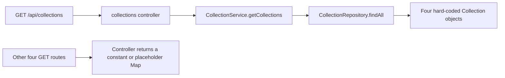

# Architecture and implementation

## Purpose and current scope

The repository appears intended to expose versioned lookup collections for addresses, languages, currencies, timezones, demographics, medical workflows, and general workflows. That purpose is inferred from the dataset names, catalog metadata, and endpoint names. The implemented runtime is much smaller: five GET handlers, a pass-through service, and an in-memory repository containing four collection summaries.

There is no database, file loader, external storage client, scheduled refresh, write API, or application-level caching implementation.

## Repository map

| Path | Responsibility |
| --- | --- |
| `pom.xml` | Maven coordinates, Java/dependency versions, Spring Boot and GraalVM build plugins |
| `src/main/java/tech/cloudfocus/ReferenceData/ReferenceDataApplication.java` | `@SpringBootApplication` entry point |
| `src/main/java/tech/cloudfocus/ReferenceData/controller/collections.java` | REST controller; the class name is literally lowercase `collections` |
| `src/main/java/tech/cloudfocus/ReferenceData/service/CollectionService.java` | Delegates collection listing to the repository |
| `src/main/java/tech/cloudfocus/ReferenceData/repository/CollectionRepository.java` | Constructs the hard-coded collection list |
| `src/main/java/tech/cloudfocus/ReferenceData/model/Collection.java` | Collection summary JavaBean |
| `src/main/resources/application.properties` | Only `spring.application.name=ReferenceData` |
| `src/test/java/tech/cloudfocus/ReferenceData/ReferenceDataApplicationTests.java` | Single context-load test |
| `data/index.json` | Seven-entry metadata catalog, currently unused at runtime |
| `data/<dataset>/v1.json` | 28 dataset files outside the application resources directory |
| `.mvn/wrapper/maven-wrapper.properties`, `mvnw`, `mvnw.cmd` | Maven wrapper configuration and launchers |
| `docs/` | Project knowledge for future agents |

At review time, `.github/` and `deploy/` are empty working-tree directories; there are no tracked CI workflows, Dockerfiles, or deployment manifests. Local `.vscode/` settings are ignored by Git. The local launch configuration points at the application main class and uses the repository as the working directory.

## Request flow

Spring discovers the controller, service, and repository below the application's base package, `tech.cloudfocus.ReferenceData`. The controller and service use constructor injection. `CollectionRepository` is a regular `@Repository` class, not a Spring Data repository interface.

`findAll()` creates a `List.of(...)` on each call. The list structure is unmodifiable; each `Collection` object is mutable through setters. No persistent state is maintained between calls.

`Collection` contains `String name`, `String kind`, `String version`, and `int count`, with a no-argument constructor, a full constructor, and getters/setters. It represents collection metadata, not an item record. It has no `blob`, `allowedRoles`, or `hasSortOrder` fields and no validation annotations. Be careful about its name collision with `java.util.Collection` when adding imports.

## Dependencies and runtime configuration

The [POM](../pom.xml) declares:

| Setting | Value |
| --- | --- |
| Coordinates | `tech.cloudfocus:ReferenceData:0.0.1-SNAPSHOT` |
| Parent | `org.springframework.boot:spring-boot-starter-parent:4.1.2` |
| Java | `25` |
| Application dependency | `spring-boot-starter-webmvc` |
| Test dependency | `spring-boot-starter-webmvc-test` |
| Build plugins | `native-maven-plugin`, `spring-boot-maven-plugin` |

There is no explicit port, context path, profile, credentials configuration, or data-directory setting. The run examples use the normal Spring Boot HTTP default of port 8080; environment variables or command-line arguments can override runtime configuration. The application name is the only checked-in property.

The POM does not declare Spring Security, OAuth resource-server support, Actuator, Spring Data, or an OpenAPI documentation library. No application code configures authentication, authorization, CORS policy, exception advice, or custom error bodies. The comment tags above `getCollections()` are comments, not a generated API specification.

## Data boundary and incomplete behavior

The repository does not read `data/index.json` or any dataset. The POM does not add the root `data/` directory as a packaged resource. Any future loader must deliberately choose how files are located and delivered with the application.

The detail and item handlers do not call the service or repository and do not validate the supplied ID. Health handlers do not inspect the repository, catalog, or downstream dependencies. The [API](api.md) documents the actual responses, and the [data catalog](data-catalog.md) documents the separate file inventory.

Potential future work includes connecting the catalog to the repository, defining item/detail response models, deciding missing-ID/version behavior, and implementing any required access control. These are observations about gaps, not an agreed implementation plan.
