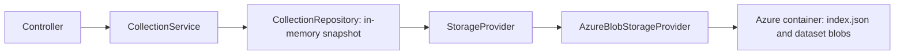

# Architecture and implementation

Updated 2026-11-14. The service uses a storage adapter boundary and an in-memory repository that owns loading and refresh. Controllers and services depend on the repository; Azure classes remain in `storage/`.

## Source map

| Class/path | Responsibility |
| --- | --- |
| `ReferenceDataApplication` | Spring Boot application entry point |
| `storage/StorageProvider` | `getETag(path)` and `read(path, expectedETag)` contract; storage-relative paths |
| `storage/AzureBlobStorageProvider` | Blob properties requests and conditional downloads, with 30-second per-operation timeout |
| `storage/StorageConfiguration` | Connection-string/container client construction, required-setting validation, scheduling enablement |
| `repository/CollectionRepository` | Startup load, validation, ETag cache, scheduled refresh, atomic publication and queries |
| `service/CollectionService` | Query delegation and unknown-ID 404 errors |
| `controller/collections` | Five GET routes under `/api`; class name remains lowercase |
| `model/Collection` | Summary JavaBean: name, kind, version, count |
| `application.properties` | Optional `.env` import, Azure connection/container and refresh mappings |

The POM pins Java 25, Spring Boot 4.1.2, `azure-storage-blob` 12.36.0, `azure-identity` 1.19.0 and `springdoc-openapi-starter-webmvc-ui` 3.2.0. Runtime uses the connection string; Azure Identity is available but unused. Spring Web MVC and its test starter are included. No database, Spring Security or Actuator is configured. The [deployment pipeline](deployment.md) builds a GraalVM native container, publishes to private GHCR, and deploys through a self-hosted Windows runner into `reference-data-2` behind the Cilium Gateway.

`config/OpenApiConfiguration` supplies the API title, relative server URL and operation-path customizer for Springdoc. Documentation and UI assets live under `/api`; relative Swagger URLs and API paths support the gateway's `/rds` prefix replacement. The Gateway has an exact-match redirect for `/rds/swagger-ui.html` to prevent Springdoc's internal welcome redirect from leaking `/api` to external browsers. See [OpenAPI endpoints](api.md#openapi-and-swagger-ui).

## Backstage catalog

The root `catalog-info.yaml` is a Backstage Component/API descriptor, packaged into `static/api` by an explicit Maven resource include and served at `/api/catalog-info.yaml`. `catalog/BackstageOpenApiController` exposes the same generated API at `/api/backstage/openapi.json` with an absolute server URL for embedded Backstage rendering. It uses a separate JSON tree so the normal relative-server document remains unchanged. See [Backstage setup](backstage.md).

## Load lifecycle

`CollectionRepository.afterPropertiesSet()` runs the initial load during bean initialization, before startup completes. Exceptions propagate and abort startup. There is no empty-cache fallback. Configuration requires a connection string and nonempty container name; refresh milliseconds must be positive.

Loading reads root `index.json` and checks `schemaVersion == 1` and a `collections` array. Each entry requires a nonempty `name`, `kind`, `version`, and `blob`. Names must be unique; kinds must be `set` or `keyValue`. Paths must be relative, cannot point to the index itself, and cannot contain traversal segments, empty segments, colons, or backslashes.

Set datasets are arrays of strings. Key/value datasets are objects whose nonblank keys map to objects with a nonblank `name`. If `hasSortOrder` is true, every record must have integer `sortOrder`. Duplicate JSON object keys and trailing JSON tokens are rejected. Counts come from the actual loaded JSON size. Item identifiers, leading zeroes and Unicode are preserved.

On refresh, the repository checks every referenced document's ETag and downloads only changed documents. Azure downloads use an `If-Match` condition matching the checked ETag. A second metadata pass rejects batches changed during staging. The full new map/list replaces a volatile snapshot in one publication only after all loading and validation succeeds. Removed catalog entries disappear on successful publication. Changed blob paths/versions are honored. Failed batches do not advance cached ETags, so the next poll retries.

Reload is synchronized to prevent overlapping batches. Requests keep reading the old snapshot during network I/O. Returned summaries are new JavaBeans and item JSON is deep-copied, protecting the internal cache from callers. Cache reads do not hit storage.

Polling uses Spring `@Scheduled` fixed delay, with the same interval for initial delay. Changing `.env` requires restart. Refresh errors retain the last successful snapshot and log only the exception type; raw SDK messages/connection details are not logged by the refresh handler. Readiness means a complete snapshot exists, not that the most recent Azure check succeeded.

## Provider extension and publishing

To add another provider, implement `StorageProvider` and supply its Spring bean in place of the Azure bean; the loader and API remain unchanged. The conditional Azure bean is a fallback when no alternative provider bean is defined. `read` must fail if the requested ETag no longer matches the object. Azure is the only production implementation today.

Azure does not offer a transaction across these blobs. The ETag checks detect updates during staging but cannot establish an application-level release boundary across separate uploads. Publish immutable versioned dataset paths first, then publish the index last when coordinated multi-file releases are needed.

Catalog `allowedRoles`, categories and terminal flags remain data rather than enforcement or workflow logic. Sort metadata is validated where declared but JSON is returned in its stored shape; no explicit sorting/filtering/paging API is implemented. Root `data/` is not configured as a packaged resource or production fallback.
